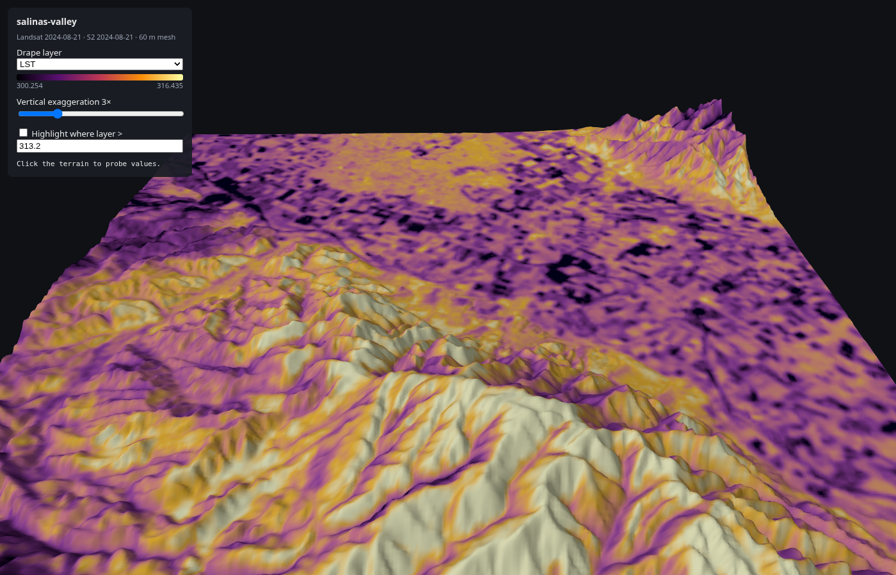

# 3dsat

Tooling (and an MCP server, `sat3d`) for **multiband satellite imagery draped on elevation in interactive 3D, with analysis**. It builds an open-data analog of [Hydrosat](https://satdocs.hydrosat.com)'s thermal + VNIR products to develop against.



See **[docs/STACK.md](docs/STACK.md)** for the Hydrosat product breakdown, the analog mapping, and stack options from laptop to large scale.

## Quick start

```bash
uv sync
uv run sat3d-build --preset salinas --out data/salinas      # ~40 s, ~25 MB
xdg-open data/salinas/viewer.html                            # interactive 3D viewer
# or any AOI:
uv run sat3d-build --bbox -121.75 36.5 -121.5 36.7 --start 2024-07-01 --end 2024-08-31 --name myaoi --out data/myaoi
```

The stack is `LST`, `LST_UNCERTAINTY`, `LWIR1_EMIS`, `BLUE/GREEN/RED/REDEDGE1-3/NIR_SR`, `CLOUD_MASK`, `NDVI` and `DEM`. Each is a float32 COG in physical units on one 30 m UTM grid, with a `manifest.json` that records the source scene ids.

Sources: Landsat 8/9 C2 L2 (Planetary Computer), Sentinel-2 L2A and Copernicus GLO-30 (AWS open data / Earth Search). No credentials are needed.

## MCP server

```bash
claude mcp add sat3d -- uv --directory /path/to/3dsat run sat3d
```

| Tool | What it does |
|---|---|
| `build_analog_stack` | Build the Hydrosat-like stack for a bbox + date window |
| `export_drape_viewer` | Write the 3D HTML viewer for a stack |
| `raster_info` | Bands, dtypes, CRS, bounds, resolution, COG tiling/overviews (local path or GDAL URI) |
| `band_stats` | Per-band min/max/mean/std/percentiles (optionally on an overview) |
